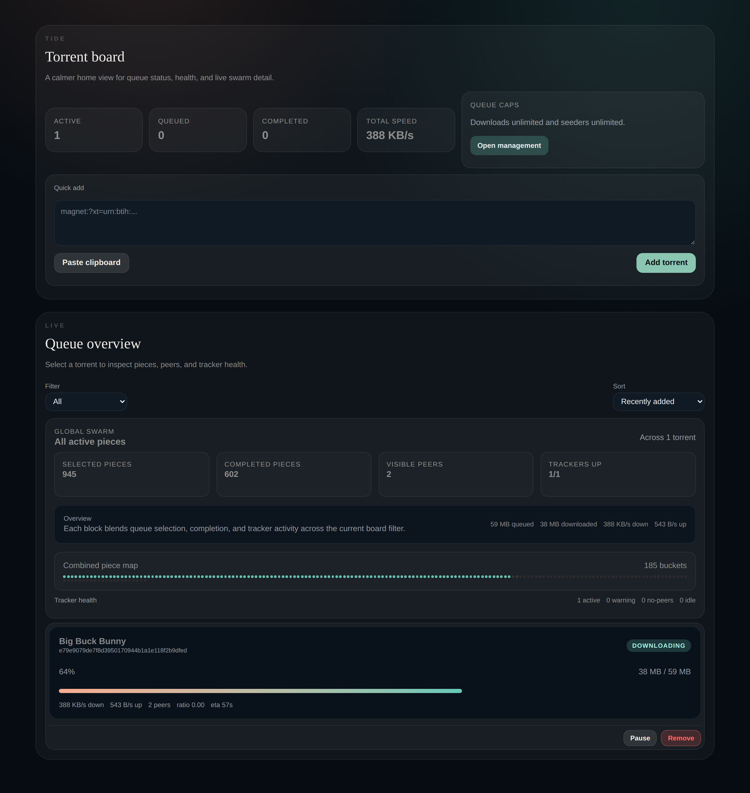
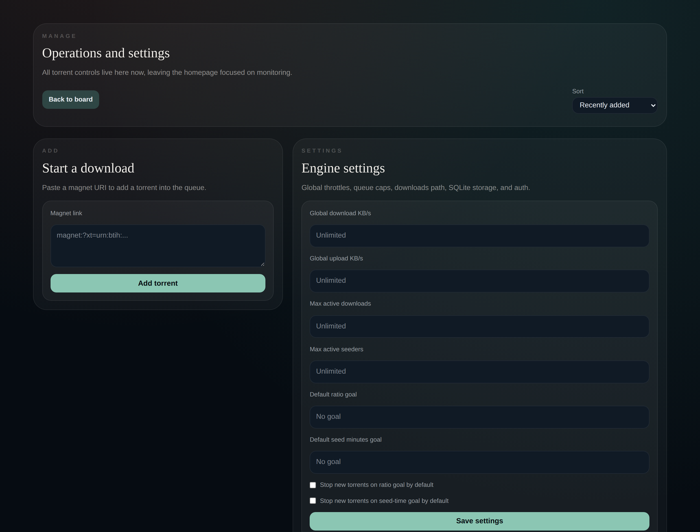

<p align="center">
  
</p>

<h1 align="center">Tide</h1>

<p align="center">
  A web torrent client for the download box next to Jellyfin.
</p>

<p align="center">
  <a href="https://github.com/sponsors/ElianCodes"></a>
  <a href="https://discord.gg/M3wzFpGbzp"></a>
  <a href="./LICENSE"></a>
  <a href="https://hub.docker.com/r/getcoral/tide"></a>
</p>

Tide is the torrent client in the [Coral](https://getcoral.dev) ecosystem. It runs as one container, shows the queue in the browser, and is built to sit beside a Jellyfin server: optional Jellyfin sign-in, and a small API other Coral modules use to see what finished.

You add magnet links. Tide enforces a cap on how many downloads and seeders run at once, lets you prioritise files by the pieces they need, and pauses the swarm when the container's memory gets tight. State lives in SQLite. There is no second database and no desktop app to keep open.

## Why Tide, and when to stay with qBittorrent or Transmission

qBittorrent and Transmission are general-purpose BitTorrent clients, and they are the better choice for a lot of people.

**Stay with qBittorrent** when you want libtorrent, a desktop app, RSS, search plugins, categories, tags, and `.torrent` files as well as magnets. Its Web UI attaches to that app.

**Stay with Transmission** when you want a small daemon (`libtransmission`) with the web UI that ships with it, remote clients, and the same kind of broad `.torrent` workflow.

**Run Tide** when the download box is a memory-capped container next to Jellyfin, and you want the website itself to be the client.

| | Tide | qBittorrent | Transmission |
| --- | --- | --- | --- |
| How you use it | The website on port 3000 is the whole app | Desktop app; Web UI is optional | Daemon with a built-in web UI |
| Active downloads and seeders | Both caps pause anything past the limit, in queue order | Both caps | Download queue and seed queue |
| Container memory | Pauses torrents and drops peers as RSS nears the cgroup limit, then resumes below a lower line | Leaves memory to the process and the cgroup killer | Leaves memory to the process and the cgroup killer |
| Who can sign in | Optional Jellyfin accounts. Anyone signed in can watch the board. Only Jellyfin administrators get `/manage` | Its own users | HTTP auth on the daemon |
| After a download finishes | Other Coral modules read `downloads.list` and `downloads.events`. On one mount, completion is a rename from `incomplete` to `complete` | A watch folder, or an *arr stack | A watch folder, or an *arr stack |
| What you can add | Magnet links | Magnets, `.torrent` files, RSS, plugins | Magnets and `.torrent` files |
| Engine | [WebTorrent](https://webtorrent.io) in Node | libtorrent | libtransmission |

Tide has no RSS feeds, search plugins, categories, or tags, and the UI does not upload `.torrent` files. The published image also leaves out WebRTC peer connections. Tracker announces and DHT still run from Node.

A fuller walkthrough of every setting is in the [Tide docs](https://docs.getcoral.dev/modules/tide/).

## Screenshots

Taken from a running Tide. The film in the queue is Big Buck Bunny, a Creative Commons download.

### Torrent board

The home view: live totals, a magnet box, the combined piece map, and the queue.



### Management

Queue caps, speed limits, and the default seeding goals applied to every new torrent.



Open a torrent on the board for its own piece map, tracker status, peer list, and a Watch link that streams a video file with HTTP range requests. Whether it plays depends on the browser understanding that container.

## Quick start

Save this as `compose.yaml`. Change the password before the port is reachable from a network you do not trust. To keep it on the machine you are sitting at, publish `127.0.0.1:3000:3000` instead.

```yaml
services:
  tide:
    image: getcoral/tide:latest
    restart: unless-stopped
    ports:
      - "3000:3000"
    environment:
      TIDE_DATA_DIR: /data
      TIDE_DOWNLOADS_DIR: /downloads/complete
      TIDE_AUTH_USERNAME: admin
      TIDE_AUTH_PASSWORD: change-me
    volumes:
      - ./tide-data:/data
      - ./downloads:/downloads
    mem_limit: 4g
    healthcheck:
      test:
        [
          "CMD",
          "node",
          "-e",
          "fetch('http://127.0.0.1:3000/healthz').then((r)=>process.exit(r.ok?0:1)).catch(()=>process.exit(1))",
        ]
      interval: 30s
      timeout: 5s
      retries: 5
      start_period: 20s
```

```bash
docker compose up -d
```

Open <http://localhost:3000>. The same image is `ghcr.io/get-coral/tide:latest`.

`./tide-data` holds `tide.sqlite` (queue, controls, sessions, Jellyfin URL). `./downloads/complete` is where finished files land. Tide puts partials in `./downloads/incomplete`, the sibling of `TIDE_DOWNLOADS_DIR`, so a finished torrent is moved with a rename. Split those two directories onto different mounts and every completion becomes a full copy.

`mem_limit` is the cap Tide reads from cgroups. With a cap and no `TIDE_MEMORY_*_MB` overrides, it pauses active torrents around 90% of that limit and resumes once RSS falls to about 75%. For an 8 GB NAS limit, a reasonable explicit set is:

```bash
TIDE_MEMORY_LIMIT_MB=8192
TIDE_MEMORY_PAUSE_MB=7168
TIDE_MEMORY_RESUME_MB=6144
```

Jellyfin, Aurora, Tide, and Librarian in one file — including the single library mount hardlinks need — is the [Coral compose guide](https://docs.getcoral.dev/getting-started/docker-compose/).

## What you get

- Paste a magnet, or paste straight from the clipboard, and watch the queue over a live stream
- Cap active downloads and active seeders. Anything past the cap waits, in queue order
- Global and per-torrent download and upload limits
- A default ratio goal and seed-time goal for every new torrent, with per-torrent overrides that stop seeding when the rule hits
- Per-file priority that selects pieces, plus a piece map, tracker status, and peer list
- A Watch link on the torrent for a video file already in the swarm
- HTTP basic auth in front of the production server, the same shape of front door as Transmission
- Optional Jellyfin sign-in. Tide stores the server URL and no API key
- Service tokens so another Coral module can read the download list

## Access control

Both layers are optional, and both are off until you turn them on.

**HTTP basic auth.** Set `TIDE_AUTH_USERNAME` and `TIDE_AUTH_PASSWORD` and the production server challenges every request before it reaches the app. It is one shared credential. `pnpm dev` does not apply it.

**Jellyfin sign-in.** Tide can require a Jellyfin account on its own, or on top of basic auth.

1. On `/manage`, set the Jellyfin server URL under Access (or set `TIDE_JELLYFIN_URL`). Tide checks the URL against `/System/Info/Public` before storing it.
2. Turn on **Require a Jellyfin sign-in**. Tide refuses to enable this until a server answers, so you cannot lock yourself out of a Tide that has nowhere to authenticate.

Once sign-in is required:

| | Signed out | Signed in | Jellyfin administrator |
| --- | --- | --- | --- |
| Board, live updates, streaming, read-only API | No | Yes | Yes |
| `/manage`, adding and removing torrents, settings | No | No | Yes |

Authentication uses Jellyfin's public `AuthenticateByName` endpoint. Signing out of Tide also revokes the Jellyfin access token it was issued. Sessions live in the same SQLite file as the rest of Tide's state and survive restarts.

If the server moves and you are locked out, start Tide with `TIDE_REQUIRE_LOGIN=false`. The environment variable overrides the stored setting in both directions.

## Memory guard

Tide watches its own RSS.

- When it can read the container memory cap from cgroups, the guard turns itself on.
- `TIDE_MEMORY_LIMIT_MB`, `TIDE_MEMORY_PAUSE_MB`, and `TIDE_MEMORY_RESUME_MB` override or force the thresholds.
- Crossing the pause line pauses active torrents and disconnects peers.
- Activity resumes only after RSS falls below the resume line.
- `TIDE_MEMORY_CHECK_INTERVAL_MS` is how often it looks. Default `5000`.

Without `mem_limit` (and without `TIDE_MEMORY_LIMIT_MB`) there is no cap to read and nothing to pause against.

## Coral modules

Tide publishes a manifest at `/api/coral/manifest` and, to a caller with a bearer token, the `downloads.list` and `downloads.events` capabilities. That is how [Librarian](https://docs.getcoral.dev/modules/librarian/) learns a download has finished. Mint a token on `/manage`, or set `CORAL_SERVICE_TOKEN` for a compose-only setup. The environment token is full access and is never written to SQLite.

`/api/coral/*` is checked by that bearer token. HTTP basic auth does not sit in front of it, so another container can call Tide without the shared password.

## Configuration

| Variable | Default | Purpose |
| --- | --- | --- |
| `TIDE_DOWNLOADS_DIR` | `./data/downloads` | Where finished downloads land. Partials go in a sibling `incomplete` directory |
| `TORRENT_DOWNLOADS_DIR` | — | Legacy alias, used only when `TIDE_DOWNLOADS_DIR` is unset |
| `TIDE_DATA_DIR` | `./data` | Directory for `tide.sqlite` |
| `TIDE_AUTH_USERNAME` | — | HTTP basic auth. Set both or neither |
| `TIDE_AUTH_PASSWORD` | — | HTTP basic auth |
| `TIDE_JELLYFIN_URL` | — | Jellyfin server used as an identity provider |
| `TIDE_REQUIRE_LOGIN` | stored setting | Forces sign-in on or off, overriding SQLite |
| `TIDE_MEMORY_LIMIT_MB` | cgroup cap | Overrides the detected container memory limit |
| `TIDE_MEMORY_PAUSE_MB` | ~90% of the limit | Pause torrents above this RSS |
| `TIDE_MEMORY_RESUME_MB` | ~75% of the limit | Resume only once RSS falls below this |
| `TIDE_MEMORY_CHECK_INTERVAL_MS` | `5000` | How often the guard re-checks |
| `CORAL_SERVICE_TOKEN` | — | Bearer token with full access for other modules |
| `HOST` | `0.0.0.0` | Bind address |
| `PORT` | `3000` | Listen port |

`/healthz` returns 204.

## Develop

Node.js 24 LTS. Node 22.5+ is the floor: Tide uses `node:sqlite`, which is not in Node 18 or 20. Package manager is pnpm 10.32.1.

```bash
pnpm install
cp .env.example .env
pnpm dev
```

The app is at <http://localhost:3000>.

```bash
pnpm dev        # Dev server on :3000
pnpm build      # Production build
pnpm start      # Production server (this is what applies basic auth)
pnpm typecheck  # TypeScript
pnpm check      # Biome lint + format
pnpm test       # Vitest
```

| Tool | Role |
| --- | --- |
| [TanStack Start](https://tanstack.com/start) | Full-stack React |
| [TanStack Router](https://tanstack.com/router) | File-based routing |
| [TanStack Query](https://tanstack.com/query) | Server state |
| [Tailwind v4](https://tailwindcss.com) | Styling |
| [Biome](https://biomejs.dev) | Lint and format |
| [WebTorrent](https://webtorrent.io) | BitTorrent engine |
| [@get-coral/jellyfin](https://github.com/Get-Coral/jellyfin) | Jellyfin API client |
| [Vitest](https://vitest.dev) | Tests |

## CI

| Workflow | When | What |
| --- | --- | --- |
| `ci.yml` | Pull requests and pushes to `main` | Typecheck, lint, test, build, Docker build |
| `docker-publish.yml` | Push to `main` and version tags | `getcoral/tide` on Docker Hub and `ghcr.io/get-coral/tide` on GHCR |
| `release-please.yml` | Push to `main` | Release PR; the image publishes when it merges |

Releases use [Release Please](https://github.com/googleapis/release-please). `feat:` bumps minor, `fix:` bumps patch, `feat!:` or `fix!:` bumps major. `docs:` and `chore:` do not bump.

## License

[MIT](./LICENSE). Copyright (c) 2026 Elian Van Cutsem.

## Part of Coral

Tide is one module in the [Coral](https://getcoral.dev) ecosystem. Read the [contributing guide](https://github.com/Get-Coral/.github/blob/main/CONTRIBUTING.md) before opening a pull request.
